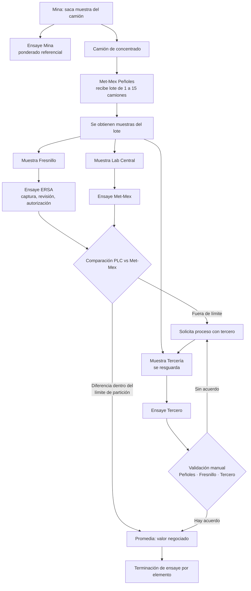
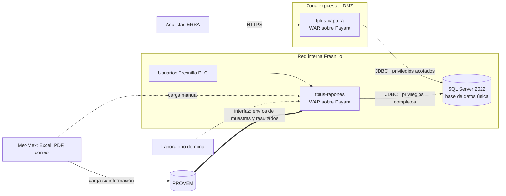

# FPlus

Sistema de seguimiento a ensayes de lotes de concentrado, desde el muestreo en mina
hasta el ensaye aplicable acordado con la contraparte.

> **Estado: Discovery activo.** El repositorio aún no contiene código de aplicación.
> Los requerimientos son preliminares (v0.1, sin baseline) y las decisiones técnicas
> de arquitectura siguen abiertas. Ver [Estado y alcance](#estado-y-alcance).

---

## Contexto

Cuando la mina envía concentrado a Met-Mex Peñoles, el valor del embarque depende del
contenido de cada elemento (Pb, Zn, Au, Ag, …). Ese contenido se determina por **ensaye**,
y cada parte —Fresnillo PLC y Met-Mex— hace el suyo sobre muestras del mismo lote.
Cuando los resultados difieren más allá del límite acordado, entra a negociación y,
excepcionalmente, a un laboratorio de tercería.

Hoy ese seguimiento vive en Excel, correos y PDFs. FPlus busca concentrarlo en un solo
sistema con historia, autoría y auditabilidad.

## Flujo end-to-end



El diagrama fuente editable está en [docs-equipo/FPlusDiagramaFlujo.drawio](docs-equipo/FPlusDiagramaFlujo.drawio)
(abrir con [draw.io](https://app.diagrams.net) o la extensión de VS Code).

## Actores

| Actor | Papel |
| --- | --- |
| **Unidad / Mina** | Genera el lote y un ponderado referencial interno. No es el resultado oficial de intercambio. |
| **ERSA** | Laboratorio representante de Fresnillo: analiza, captura y recorre revisión y autorización. |
| **Fresnillo PLC** | Revisión interna, liberación, intercambio y decisiones comerciales. |
| **Met-Mex** | Contraparte del intercambio: ensaye propio, archivos y entrega de muestra. |
| **Laboratorio de tercería** | Analiza los elementos solicitados en caso de desacuerdo. Su resultado no es automáticamente el aplicable. |

## Capacidades previstas

Captura de ensayes por elemento · revisión y liberación · conciliación interna ·
intercambio con Met-Mex · negociación · tercería · resolución del valor aplicable ·
ciclos de re-ensaye · historia y auditoría · condiciones contractuales por vigencia ·
importación y exportación.

Cubiertas por 36 requerimientos funcionales y 26 no funcionales preliminares
(ver [Documentación](#documentación)).

## Arquitectura

El sistema se compone de **dos módulos desplegables por separado contra una misma base de
datos**. La separación no es técnica sino de audiencia y exposición: distintos usuarios,
distintas redes, distinto perfil de riesgo.

| | `fplus-captura` | `fplus-reportes` |
| --- | --- | --- |
| **Audiencia** | Analistas de ERSA | Fresnillo PLC (usuarios de consulta y decisión) |
| **Red** | Posible exposición a internet | Red interna |
| **Naturaleza** | Transaccional, pocas pantallas, alta frecuencia | Lectura intensiva, consultas e informes |
| **Alcance funcional** | Captura de ensayes por elemento, revisión y autorización | Ingesta de Met-Mex y laboratorio de mina, conciliación, intercambio, negociación, tercería, historia y salidas |
| **RF (mapeo propuesto)** | RF-001 – RF-011 | RF-012 – RF-036 |

`fplus-reportes` es el centro de gravedad del sistema: concentra lo que manda Met-Mex y lo
que manda el laboratorio de mina, y es donde se resuelve el valor aplicable.

### Topología de despliegue



Que un módulo pueda salir a internet y el otro no obliga a que sean **dos desplegables
independientes**, no dos WAR dentro de un mismo EAR: no se puede colocar medio EAR en una
DMZ. El código compartido vive en una biblioteca, no en el contenedor.

### Estructura de proyecto propuesta

```
fplus/
├── pom.xml              POM padre (Maven multi-módulo)
├── fplus-domain/        JAR  · entidades JPA, enums, reglas de dominio, persistence.xml
├── fplus-ui/            JAR  · tema propio, layout y componentes compuestos
├── fplus-captura/       WAR  · JSF + PrimeFaces · ERSA
└── fplus-reportes/      WAR  · JSF + PrimeFaces · Fresnillo PLC
```

Las entidades JPA y el `persistence.xml` viven en `fplus-domain`; cada WAR aporta
únicamente el nombre JNDI de su propio datasource. Así los dos módulos comparten el mapeo
del esquema sin duplicarlo.

### Base de datos compartida

La integración entre módulos es **a través de la base de datos**, no por API. Es la opción
correcta aquí: un solo equipo, un solo esquema, y un módulo de reportes que necesita ver
absolutamente todo lo que captura el otro. Una API intermedia solo agregaría latencia y una
capa que mantener.

A cambio, **el esquema es el contrato**. Dos implicaciones prácticas:

- **Migraciones versionadas y coordinadas** (Flyway en `fplus-domain`, ADR-005 y ADR-018). Un
  cambio de esquema afecta a los dos módulos y ninguno puede desplegarse a ciegas.
- **Privilegios distintos por módulo.** `fplus-captura` está expuesto: su usuario de base de
  datos debe alcanzar solo las tablas de captura y con los permisos mínimos. Si ese módulo
  se compromete, el daño queda acotado. `fplus-reportes`, interno, conserva privilegios
  completos porque además escribe la ingesta de Met-Mex y de mina.
- **Edición concurrente** (NFR-012): dos módulos escribiendo sobre el mismo lote requieren
  una estrategia explícita de bloqueo. El bloqueo optimista de JPA con `@Version` es el
  punto de partida razonable.

### APIs

| Frontera | Decisión |
| --- | --- |
| Entre `fplus-captura` y `fplus-reportes` | **Sin API.** Integración por base de datos compartida. |
| Hacia Met-Mex | **Sin API.** Lo que no entre por PROVEM es archivo y correo; el acceso técnico a Met-Mex no está aprobado. |
| Hacia PROVEM | **Interfaz confirmada.** FPlus extrae de PROVEM los envíos de muestras y algunos resultados; es donde Met-Mex carga su información. Tipo de interfaz, contrato de datos y llaves: TBD. |
| Hacia terceros (laboratorios de tercería) | Por decidir. El acceso directo no está aprobado. |

Recomendación: no introducir REST **de salida** hasta que exista un consumidor real y
concreto (Power BI, una app móvil). La interfaz con PROVEM es una **entrada** y ya está
confirmada. Si hiciera falta exponer algo, el candidato natural es `fplus-reportes`, que es
donde está el dato consolidado.

### Decisiones abiertas de esta arquitectura

- **¿Qué significa exactamente "salida a internet"?** Si los analistas de ERSA entran desde
  fuera de la red de Fresnillo, hace falta definir identidad, sesión y MFA antes de diseñar
  las pantallas (NFR-017). Si en realidad entran por VPN o enlace dedicado, el módulo deja
  de necesitar DMZ y el diseño se simplifica bastante. Es la decisión de mayor impacto
  pendiente.
- **Dónde corta la frontera entre los dos módulos.** ERSA captura y recorre revisión y
  autorización; Fresnillo PLC hace revisión interna y liberación. El punto exacto del
  relevo depende de P02 (roles, suplencias y evento de liberación), que sigue abierto. El
  mapeo de RF de la tabla es una propuesta, no un acuerdo.
- **Dónde vive la ingesta.** Asignada a `fplus-reportes`. **Ya no es hipotético:** la
  interfaz de PROVEM confirma una ingesta automática o programada, así que conviene evaluar
  sacarla a un componente propio: un proceso programado dentro de una aplicación web se
  ejecuta tantas veces como instancias haya.
- **Navegadores y dispositivos** de usuarios internos y de ERSA (NFR-022): sin definir, y
  condiciona a PrimeFaces.

## Stack tecnológico

| Componente | Versión |
| --- | --- |
| Java | 25 |
| Jakarta EE | 11 |
| PrimeFaces | 16 · sin tema incluido, se diseña propio |
| Apache Shiro | 2.x · configurado por código, sin `shiro.ini` |
| Payara Server | 7.2026.8 |
| SQL Server | 2022 |

> Decisiones **aún no tomadas**: eventos y colas, alojamiento, DW/BI y Power BI, SSO
> concreto y acceso directo de terceros. No inferir selección tecnológica a partir de los
> nombres del sistema actual (PROVEM, SISLIQ, BDO).

## Estructura del repositorio

```
FPlus/
├── docs-equipo/          Documentación de trabajo del equipo (Discovery, diagramas)
├── .blitzyignore         Rutas excluidas del contexto de Blitzy
├── .gitignore
└── README.md
```

## Documentación

En [docs-equipo/](docs-equipo/):

| Documento | Contenido |
| --- | --- |
| `EMB_Requerimientos_Funcionales_Preliminares_v0.1` | 36 RF preliminares (RF-001 a RF-036) |
| `EMB_Requerimientos_No_Funcionales_Preliminares_v0.1` | 26 NFR preliminares (NFR-001 a NFR-026) |
| `EMB_Architecture_Inputs_Preliminares_v0.1` | Actores, fronteras, sistemas observados y pendientes |
| **[Arquitectura/](docs-equipo/Arquitectura/)** | **Documentación de arquitectura base: módulos, despliegue, datos, seguridad y ADR** |
| `FPlusDiagramaFlujo.drawio` | Diagrama del flujo end-to-end |

La documentación de arquitectura vive en [docs-equipo/Arquitectura/](docs-equipo/Arquitectura/)
y tiene su propio [índice](docs-equipo/Arquitectura/README.md).

> La carpeta `docs-equipo/` está listada en `.blitzyignore`: es material de trabajo humano
> y no forma parte del contexto que consume Blitzy.

## Estado y alcance

Los tres documentos v0.1 son **preliminares, borrador, sin baseline y sin requerimientos
validados**. Sirven para plantear preguntas de arquitectura y sus dependencias; no son
diseño de solución ni paquete listo para implementación.

Pendientes abiertos que **no deben convertirse en supuestos**:

- **Resultado negociado y tercería** — el valor aplicable por elemento no está definido.
  No implementar el negociado como número final ni una fórmula universal del tercero.
- **Autoridades** — roles, suplencias, visibilidad y evento de liberación por definir.
- **Salidas y valores** — formatos reales, selección Au/Ag, cero frente a ausencia,
  unidades y precisión por definir.
- **Contrato** — reglas, límites de partición y autoridad por definir. Los números de
  los ejemplos son ilustrativos, no configuración.
- **Ciclos** — sin máximo artificial; no asumir dos columnas o dos ciclos.
- **Integración** — llaves, duplicados, fallos parciales y carga real por definir.

Siguiente paso sugerido: validar el flujo con un lote Pb y uno Zn, una devolución o
confirmación, una negociación con Met-Mex y un caso de tercería.

## Glosario

| Término | Significado |
| --- | --- |
| **Ensaye** | Análisis de laboratorio que determina el contenido de un elemento en una muestra. |
| **Lote** | Agrupación de 1 a 15 camiones recibida en destino; unidad de intercambio. |
| **ERSA** | Laboratorio que representa a Fresnillo PLC en el ensaye oficial. |
| **Límite de partición** | Diferencia máxima tolerada entre el ensaye de PLC y el de Met-Mex antes de escalar. |
| **Negociado** | Valor acordado entre las partes cuando la diferencia cae dentro del límite. |
| **Tercería** | Laboratorio independiente que interviene en caso de desacuerdo. |
| **Valor aplicable** | Resultado que finalmente rige la liquidación, resuelto por elemento. |

## Reglas vinculantes para el código

> **Estas reglas no son preliminares y no se negocian caso por caso.** Aplican a todo código
> que se escriba o genere para FPlus, incluido el producido por agentes. Un incumplimiento
> reprueba la revisión.

Objetivo de seguridad: **OWASP ASVS 5.0, niveles 1 y 2**, para todo control satisfacible en
código de aplicación. Donde un control no sea satisfacible en código, se genera lo que una
implementación conforme requiere y se declara la obligación residual al entregar.

### Estructura

- **Dos desplegables independientes**: `fplus-captura` (ERSA) y `fplus-reportes` (Fresnillo
  PLC). Nunca un solo WAR ni un EAR con ambos.
- **Sin API, cola ni llamada remota entre los dos módulos.** Se integran por la base de datos
  compartida.
- Código común en `fplus-domain` (dominio y persistencia) y `fplus-ui` (tema e interfaz).
  Ningún estilo se escribe dentro de un WAR.
- Base de datos **única**, dividida en cinco esquemas: `ops`, `cfg`, `aud`, `seg_cap`,
  `seg_rep`.

### Identidad y acceso

- **Apache Shiro 2.x configurado por código.** `shiro.ini` está prohibido. Shiro 1.x no sirve:
  usa `javax.servlet`.
- **Identidad segregada por módulo.** `fplus-captura` usa `seg_cap`; `fplus-reportes` usa
  `seg_rep`. Cada uno tiene `DENY` sobre el esquema del otro. Ningún módulo toca ambos.
- **La autoridad nunca se deriva de los grupos o atributos de un proveedor de identidad.**
  Un SSO aportaría autenticación; los permisos se resuelven contra las tablas propias.
- El código comprueba **permisos** (`ensaye:capturar`), no roles, y lo hace en la capa de
  servicio, no solo en la vista. Sin comodines en las asignaciones.
- **Argon2id** para contraseñas. **bcrypt está prohibido**: trunca a 72 bytes.
- La contraseña se verifica **exactamente como se recibe**: sin recortar, sin plegar
  mayúsculas, sin normalizar, sin restringir caracteres.
- Identificadores de sesión desde `SecureRandom`, 32 bytes. **Un UUID no cumple**, y el
  generador por omisión de Shiro es de UUID: hay que sustituirlo.
- **Toda autenticación emite un identificador de sesión nuevo** e invalida el anterior.
- Cookies con prefijo `__Host-`, `Secure`, `HttpOnly`, `Path=/`, sin `Domain`.
- `RememberMe` deshabilitado.


### Directorio (LDAP)

- **Un solo realm** para todos los directorios. La lista se lee de un archivo de propiedades
  y se carga en memoria: agregar un directorio es configuración, no código.
- Un **directorio lógico** puede tener varios servidores; entre ellos es conmutación por
  error.
- **El directorio del usuario se resuelve desde su cuenta local antes de conectar.** Nunca se
  recorren todos hasta que alguno valide: uno de los directorios pertenece a otra
  organización, y un recorrido ciego le entregaría contraseñas que no le corresponden.
- La identidad local es el par **(directorio, usuario)**, no el usuario suelto.
- **Sin alta automática de cuenta.** Validar contra un directorio no crea acceso: la cuenta
  local provisionada con roles es la compuerta.
- `fplus-captura` **no usa LDAP**: ERSA es externo y usa credenciales locales con Argon2id.
- Escapado **RFC 4515** en filtros de búsqueda y **RFC 4514** en DN. Sin concatenación.
- **LDAPS o StartTLS siempre**, certificado validado, versión mínima explícita. Sin `ldap://`
  en claro, tampoco en desarrollo.
- **Sin bind anónimo** para la búsqueda. **Rechazar el bind con contraseña vacía**: muchos
  servidores lo tratan como anónimo y responden éxito.
- Registrar en auditoría **qué directorio validó**.

### Salida y entrada

- Toda respuesta emite `Content-Security-Policy` (al menos `object-src 'none'`,
  `base-uri 'none'` y `frame-ancestors`), `X-Content-Type-Options: nosniff`,
  `Referrer-Policy` y `Strict-Transport-Security` con `max-age` de un año e
  `includeSubDomains`. `Cache-Control: no-store` en toda respuesta con datos sensibles.
- **Nunca concatenar** un valor externo en SQL, un nombre JNDI, un filtro LDAP, una cabecera
  de correo o una línea de registro.
- Rechazar retorno de carro y salto de línea en cualquier valor usado como cabecera de
  correo, **incluidas las direcciones leídas de la base de datos**.
- Sanear todo valor externo antes de registrarlo. **Nunca registrar** contraseñas, hashes,
  tokens ni identificadores de sesión.
- Los formularios se vinculan a **objetos propios con campos explícitos**, nunca a una
  entidad `@Entity`.
- La dirección del cliente sale de la conexión. Una cabecera de reenvío solo es confiable si
  un proxy de confianza la **sobrescribe**.
- **TLS en toda conexión**, incluida la de base de datos, con versión mínima explícita.
- Tokens autocontenidos: hoy no se usan. Si se introducen, lista explícita de algoritmos,
  rechazo de `none` y del material de clave que el token nombre, y validación de `audience`.

### Datos

- Un valor de ensaye tiene **cuatro estados** además del número: cero real, pendiente,
  ausente y no aplica. Ninguna capa puede colapsarlos. Una columna anulable no alcanza.
- Los ciclos de reensaye van como **filas**, nunca como columnas fijas. Sin máximo.
- `DECIMAL` con precisión explícita para valores de ensaye. Nunca `FLOAT`.
- **Sin borrado físico** en `ops` ni en `aud`. La historia no se borra.
- Migraciones Flyway versionadas, que incluyen los `GRANT` y `DENY`.

### Prohibido

1. Concatenar cualquier valor externo en un filtro LDAP, un nombre JNDI, una sentencia SQL,
   una cabecera de correo o una línea de registro.
2. Desactivar el escapado de salida en una plantilla o vista (`escape="false"`).
3. Cualquier clase, endpoint o configuración de prueba dentro del artefacto de producción.
4. Un gestor de confianza permisivo, una verificación de certificado desactivada, o un
   retroceso a texto plano en cualquier protocolo, **tampoco en desarrollo**.
5. Un valor por omisión para cualquier secreto, y cualquier secreto en el código fuente, en
   un artefacto de compilación o en un registro. Si falta un secreto, la aplicación **falla
   al arrancar**.
6. Derivar autoridad de los grupos o atributos de un proveedor de identidad.

### Pruebas obligatorias

- Toda autenticación emite un identificador de sesión nuevo.
- Toda respuesta lleva el juego completo de cabeceras.
- `fplus-captura` no puede leer `seg_rep`. Debe fallar la construcción si el `DENY`
  desaparece.
- Un intento de autenticación contacta **solo** al directorio de la cuenta, nunca a los demás.

### Puerta de revisión

El código no se integra si introduce un patrón prohibido, si alguna respuesta no lleva las
cabeceras, si alguna escritura a directorio, correo o registro no escapa sus entradas, o si
alguna autenticación no emite un identificador de sesión nuevo.

> El detalle de cada control, las obligaciones residuales que corresponden a TI y la lista
> verificable para revisar un AAP están en `docs-equipo/Arquitectura/`, documentos 10 y 11.
> Esa carpeta no forma parte del contexto que consume Blitzy: **las reglas de arriba son
> autosuficientes y bastan para cumplir.**

## Desarrollo

Pendiente de definir: build, ejecución local, base de datos de desarrollo y pruebas.
Se documentará aquí al arrancar la implementación.

## Ramas

- `main` — rama principal.
- `blitzy-branch` — rama de trabajo de las corridas de Blitzy.
