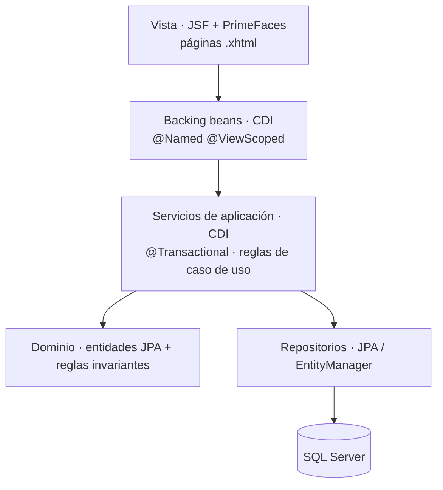
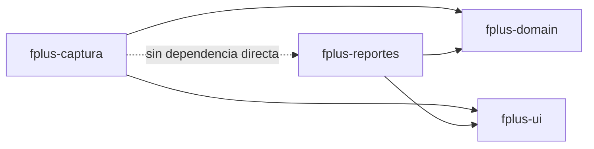
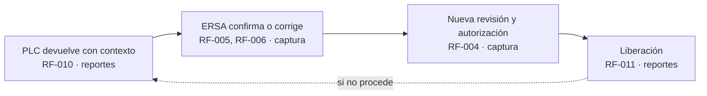

# 02 · Vista de módulos

> Estado: PRELIMINAR · línea base de trabajo v0.1

## Los dos módulos

| | `fplus-captura` | `fplus-reportes` |
| --- | --- | --- |
| **Audiencia** | Analistas de ERSA | Fresnillo PLC |
| **Red** | Posible exposición a internet (TBD) | Red interna |
| **Naturaleza** | Transaccional: pocas pantallas, uso intensivo | Lectura intensiva: consultas, análisis e informes |
| **Volumen de pantallas** | Bajo | Alto |
| **Perfil de riesgo** | Alto: superficie expuesta | Medio: interno |
| **RF (mapeo)** | RF-001 – RF-007, RF-032 | RF-008 – RF-031, RF-033 – RF-036 |

`fplus-reportes` es el centro de gravedad: concentra lo que manda Met-Mex y el laboratorio
de mina, y es donde se resuelve el valor aplicable.

## Responsabilidades

### `fplus-captura` — ERSA

- Captura de ensayes por elemento sobre las muestras del lote.
- Corrección de elementos antes de la autorización.
- Recorrido de revisión y autorización interna de ERSA.
- Solicitud y gestión de reensaye de la misma muestra (RF-022, actor compartido).
- Atención de las devoluciones que envía PLC: confirmar, corregir o rehacer revisión (RF-005, RF-006).
- Consulta acotada de lo que el propio ERSA capturó.
- Exportación a Excel en el formato de controles de ERSA (RF-032), **claramente
  diferenciada de la cédula externa**.

**No hace:** intercambio con Met-Mex, negociación, tercería, ni consulta de información
comercial. Esa separación es un requerimiento, no una comodidad (NFR-008).

### `fplus-reportes` — Fresnillo PLC

- Ingesta de los archivos que manda Met-Mex y de la información del laboratorio de mina.
- Comparación del Resultado ERSA contra el ponderado de mina (RF-008) y señalamiento de diferencias (RF-009).
- Devolución a ERSA para confirmación, corrección o revisión (RF-010).
- **Liberación** del Resultado ERSA conforme como oficial PLC (RF-011).
- Conciliación externa: comparación del resultado oficial PLC contra el de Met-Mex (RF-014).
- Intercambio: registro del envío y la recepción con la contraparte.
- Negociación y registro de la decisión.
- Solicitud y registro de tercería.
- Resolución del valor aplicable por elemento.
- Gestión de ciclos de reensaye y remuestreo.
- Consulta de historia, versiones, eventos y responsables.
- Condiciones contractuales por contexto y vigencia.
- Salidas e informes.

## Capas dentro de cada módulo

Ambos módulos comparten la misma estratificación Jakarta EE:



Reglas de dependencia:

- La vista **nunca** toca repositorios ni el `EntityManager` directamente.
- Los backing beans no contienen reglas de negocio: orquestan y presentan.
- Las reglas de negocio viven en servicios de aplicación y en el dominio.
- El dominio no conoce JSF, ni la petición HTTP, ni el módulo en el que corre.

## Estructura Maven

```
fplus/
├── pom.xml                  POM padre · gestión de versiones y plugins
├── fplus-domain/            JAR
│   ├── entidades JPA del esquema operativo
│   ├── enums y objetos de valor del dominio
│   ├── reglas invariantes del dominio
│   ├── repositorios
│   ├── persistence.xml
│   └── migraciones Flyway (db/migration)
├── fplus-ui/                JAR
│   ├── tokens de diseño y skin de componentes PrimeFaces
│   ├── plantilla de layout (Facelets)
│   ├── componentes compuestos reutilizables
│   └── iconografía
├── fplus-captura/           WAR · desplegable independiente
└── fplus-reportes/          WAR · desplegable independiente
```

### Por qué `fplus-domain` es un JAR y no un tercer despliegue

Es una biblioteca, no un servicio. Se empaqueta dentro de cada WAR. Los módulos comparten
**el mapeo del esquema**, no un proceso en ejecución: no hay llamada remota entre ellos.

El `persistence.xml` vive en `fplus-domain`; cada WAR aporta únicamente el nombre JNDI de
su propio datasource. Así las entidades se declaran una sola vez y cada módulo se conecta
con su propio principal de base de datos y sus propios privilegios (ver
[05 · Seguridad](05-seguridad-y-control-de-acceso.md)).

### Qué NO va en `fplus-domain`

- Entidades de identidad. Los usuarios, roles y permisos de cada módulo son **distintos y
  privados de cada módulo**; viven en el WAR correspondiente
  ([ADR-004](adr/ADR-004-identidad-segregada-por-modulo.md)).
- Backing beans, componentes JSF o cualquier cosa que dependa de la vista.
- Lógica específica de un solo módulo.

### `fplus-ui`, el artefacto de interfaz

PrimeFaces 16 no aporta un tema listo para usar: **el tema se diseña completo**. Como los
dos módulos son un solo sistema para el negocio, ese tema vive en un artefacto compartido
(`fplus-ui`) del que dependen ambos WAR, en lugar de duplicarse como CSS en cada uno
([ADR-007](adr/ADR-007-tema-propio-compartido.md)).

Regla estricta: **ningún estilo se escribe en una pantalla.** Si falta algo, se agrega al
tema para los dos módulos. El detalle está en [09 · Interfaz y tema](09-interfaz-y-tema.md).

## Dependencias entre módulos



`fplus-captura` y `fplus-reportes` **no se conocen**. No hay dependencia de compilación, ni
llamada HTTP, ni cola de mensajes entre ellos. Lo único que comparten es el esquema
operativo de la base de datos y la biblioteca que lo mapea.

Consecuencia operativa: un cambio en `fplus-domain` o en `fplus-ui` obliga a recompilar y redesplegar
**ambos** módulos. Es el precio de la integración por base de datos y está aceptado en
[ADR-002](adr/ADR-002-integracion-por-base-de-datos.md).

## La frontera entre los módulos no es un corte limpio

El mapeo de RF de arriba sale del actor principal que declara cada requerimiento. El corte
grueso es claro: la sección «Captura y control ERSA» abarca RF-001 a RF-007, y «Revisión
interna y liberación» empieza en RF-008 ya con Fresnillo PLC como actor.

Pero **no es contiguo**. Cuatro requerimientos vuelven a nombrar a ERSA fuera de ese
bloque:

| RF | Actor declarado | Implicación |
| --- | --- | --- |
| RF-022 · gestionar reensaye | «ERSA / solicitante; facultad TBD» | Actor compartido: sin decidir quién lo inicia |
| RF-030, RF-031 | «ERSA / equipo interno» | Actor compartido |
| RF-032 · exportación ERSA | «Usuario ERSA» | Claramente del módulo de captura |

Esos tres casos de actor compartido **no se resuelven con criterio técnico**: dependen de
P02 (facultades y suplencias). Hasta entonces, el diseño mantiene la frontera **movible**:
la regla vive en un servicio del dominio invocable desde cualquiera de los dos módulos, no
incrustada en la vista de uno.

### Liberación: es de PLC

RF-011 lo declara con actor **Fresnillo PLC**, y precisa que la liberación conserva el mismo
valor como oficial PLC «sin crear un segundo ensaye numérico». RF-004 lo dice desde el otro
lado: «autorización ERSA no equivale a liberación PLC».

Queda por tanto en `fplus-reportes`. Lo que sigue abierto por P02/P03 no es **en qué
módulo** ocurre, sino **quién libera y cuál es el evento exacto**.

### El lazo que cruza los dos módulos

RF-010 crea una interacción de ida y vuelta entre módulos:



Ese lazo atraviesa los dos desplegables y **se resuelve por la base de datos compartida**,
sin API ([ADR-002](adr/ADR-002-integracion-por-base-de-datos.md)). La solicitud que crea PLC
debe ser recuperable por ERSA desde `fplus-captura`, con su contexto de lote. Es el caso de
uso que mejor justifica esa decisión de integración.
