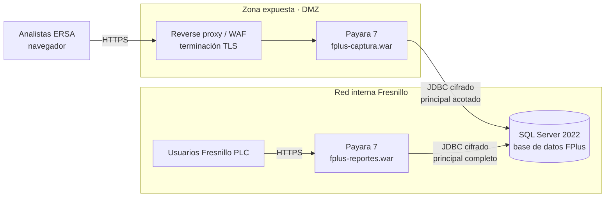
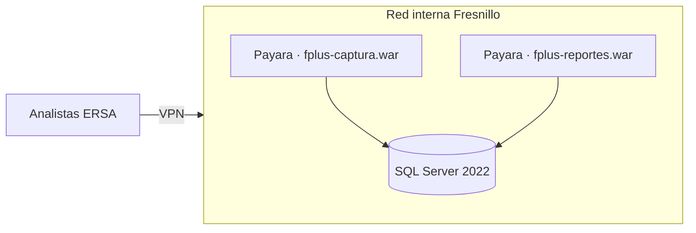

# 03 · Vista de despliegue

> Estado: PRELIMINAR · línea base de trabajo v0.1
> La topología depende de un pendiente abierto: **si ERSA entra desde internet o por
> VPN/enlace dedicado**. Este documento describe el escenario expuesto, que es el más
> exigente; el escenario VPN se documenta como alternativa.

## Escenario A · ERSA accede desde internet

Controles que exige este escenario:

- **TLS obligatorio** de extremo a extremo; sin HTTP en claro en ningún tramo.
- **Reverse proxy o WAF** delante del módulo expuesto; Payara no se expone directamente.
- **Regla de firewall de un solo sentido**: la DMZ alcanza el puerto de SQL Server; la red
  interna no acepta conexiones entrantes desde la DMZ hacia nada más.
- **Conexión JDBC cifrada** (`encrypt=true`), con validación de certificado del servidor.
- **Principal de base de datos acotado** para `fplus-captura`: sin ningún privilegio sobre
  el esquema de identidad del módulo interno (ver
  [05 · Seguridad](05-seguridad-y-control-de-acceso.md)).

## Escenario B · ERSA accede por VPN o enlace dedicado

Si se confirma este escenario, **desaparece la DMZ y el WAF**, y la política de identidad
se simplifica de forma considerable. La segregación de identidad y de privilegios de base
de datos **se mantiene igual**: sigue respondiendo a NFR-008 (confidencialidad comercial
entre audiencias), que es independiente de la topología de red.

> **Decidido el 2026-10-21** ([ADR-011](adr/ADR-011-captura-para-internet.md)): la primera etapa opera como el
> escenario B (VPN, equipos prestados por Fresnillo) y el módulo se construye para el escenario A, al que pasará
> después. Lo que agrega el escenario A (WAF, DMZ, firewall) es infraestructura de TI y no cambia el WAR.

## Instancias de Payara

Dos instancias separadas, una por módulo. No es una preferencia: en el escenario A viven en
redes distintas, y **no se puede colocar medio EAR en una DMZ**. Por eso los módulos son
dos WAR independientes y no dos módulos de un mismo EAR
([ADR-001](adr/ADR-001-dos-modulos-desplegables.md)).

En el escenario B podrían coexistir en una misma instancia, pero se recomienda mantenerlas
separadas: permite reiniciar, actualizar o dimensionar cada módulo sin afectar al otro, y
conserva la separación de principales de base de datos.

## Entornos

| Entorno | Propósito | Datos |
| --- | --- | --- |
| **DEV** | Desarrollo local | Datos sintéticos |
| **QA** | Pruebas de negocio y validación de flujo | Datos sintéticos o anonimizados |
| **PROD** | Operación | Reales |

Reglas:

- Ningún entorno distinto de PROD se conecta a la base de datos de PROD.
- Las credenciales y cadenas de conexión **no** se versionan: viven en la configuración del
  dominio de Payara, no en el WAR.
- El mismo artefacto (`.war`) promueve de QA a PROD sin recompilar. Lo único que cambia es
  la configuración del servidor.

> **TBD:** número de entornos definitivo, ventanas de despliegue, continuidad, respaldo,
> RTO y RPO (NFR-013 a NFR-016). Requiere definición de TI.

## Configuración externa al artefacto

| Qué | Dónde | Por qué |
| --- | --- | --- |
| Datasource JDBC y credenciales | Dominio de Payara (JNDI) | No versionar secretos; permite promover el mismo WAR |
| Parámetros de entorno | Variables de entorno / MicroProfile Config | Distinto por entorno |
| Condiciones contractuales y límites de partición | **Base de datos, no configuración** | Tienen vigencia y deben quedar en historia (RF-034–036) |

El último punto importa: los límites de partición y las reglas de contrato **no son
configuración de despliegue**. Cambian en el tiempo, deben conservar su vigencia y ser
auditables. Van en tablas, no en un archivo de propiedades.

## Alojamiento

**TBD.** Nube frente a servidores propios no está decidido, y no debe inferirse del hecho
de que se use Payara. La arquitectura descrita funciona en ambos casos.
