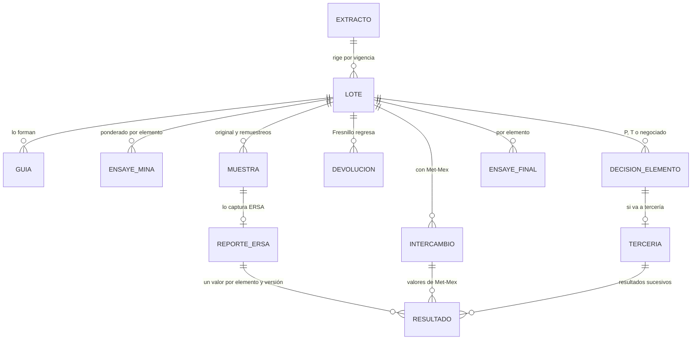
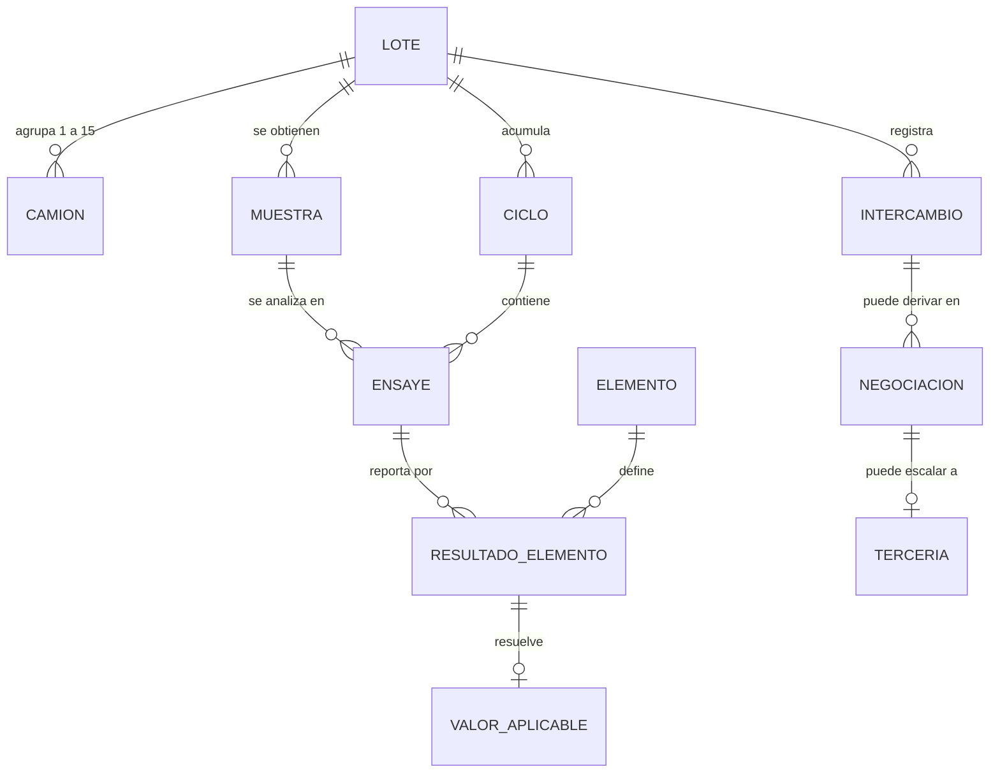

# 04 · Modelo de datos

> Estado: PRELIMINAR · línea base de trabajo v0.1
> El modelo conceptual de abajo es una primera aproximación derivada del flujo observado.
> Las entidades del intercambio, la negociación y el valor aplicable dependen de P01, P05 y
> P07, que siguen abiertos. **No tomar este modelo como esquema final.**

## Una base de datos, varios esquemas

La base de datos es **única** (`FPlus`), pero está dividida en **esquemas de SQL Server**
con privilegios distintos por módulo. La división no es cosmética: es el mecanismo que
contiene el daño si el módulo expuesto a internet se ve comprometido
([ADR-003](adr/ADR-003-bd-unica-esquemas-separados.md)).

| Esquema | Contenido | `fplus-captura` | `fplus-reportes` |
| --- | --- | --- | --- |
| `ops` | Dominio operativo: lotes, muestras, ensayes, ciclos, intercambio, negociación, tercería | Acotado: solo captura | Completo |
| `cfg` | Catálogos y condiciones contractuales por vigencia | Solo lectura de catálogos | Completo |
| `aud` | Historia y auditoría · append-only | Solo `INSERT` | `INSERT` + `SELECT` |
| `seg_cap` | **Identidad del módulo de captura**: usuarios, credenciales, roles, permisos de ERSA | Completo | **DENY** |
| `seg_rep` | **Identidad del módulo de reportes**: usuarios, credenciales, roles, permisos de PLC | **DENY** | Completo |

El punto importante: **`fplus-captura` no puede leer `seg_rep`, ni siquiera para consultar.**
Si alguien compromete el módulo expuesto —inyección SQL, credencial filtrada, lo que sea—
no obtiene las credenciales de los usuarios internos de Fresnillo, porque el principal de
base de datos con el que se conecta no tiene permiso alguno sobre ese esquema. La
separación la impone el motor, no el código de la aplicación.

El detalle de los `GRANT` y `DENY` está en
[05 · Seguridad y control de acceso](05-seguridad-y-control-de-acceso.md).

## Modelo conceptual operativo (`ops`) · revisión 2026-10-21

Esta revisión sale de los requisitos con cita de las juntas (`docs/requisitos/requisitos.md`, RF-001 a RF-107) y
**sustituye al modelo preliminar** que sigue más abajo, que se conserva como historia. Cambios principales: el lote
llega de PROVEM y no se captura; la muestra tiene **tipo** (original, primer o segundo remuestreo) en lugar de ciclos
numerados; la decisión se toma **por elemento**; el extracto de contrato manda qué elementos y límites aplican.

### Análisis de sustantivos

| Sustantivo (glosario o requisito) | Es | Dónde |
| --- | --- | --- |
| Compañía, unidad, producto | Catálogos | `cfg` |
| Elemento (Au, Ag, Pb, Zn…) y su unidad | Catálogo | `cfg` |
| Extracto de contrato, su vigencia, sus elementos con condición, límites de partición por rango, regla de ensaye final, regla de asignación del tercero | Configuración funcional con vigencia | `cfg` |
| Laboratorio tercero, representante | Catálogos | `cfg` |
| Lote (lote de la unidad, lote Met-Mex, fecha de cierre, peso seco) | Entidad, origen PROVEM | `ops.lote` |
| Guía (camión) | Entidad hija del lote, origen PROVEM (P-006: si hace falta su detalle) | `ops.guia` |
| Ponderado de la mina | Valor por lote y elemento, origen PROVEM | `ops.ensaye_mina` |
| Muestra (tipo, fechas de entrega, recepción, estimada, código del sobre) | Entidad | `ops.muestra` |
| Captura de ERSA (estado del flujo, quién revisó y autorizó, fecha de entrega de resultados) | Entidad por muestra | `ops.reporte_ersa` |
| Ensaye por elemento (valor, estado del valor, unidad, quién y cuándo) | Entidad; nunca se sobrescribe | `ops.resultado` |
| Devolución de Fresnillo (lotes, observación, resolución) | Entidad | `ops.devolucion` |
| Intercambio con Met-Mex (fecha, cédula, archivo recibido) | Entidad | `ops.intercambio` |
| Decisión por elemento (INT sugerido, RN decidido) | Entidad | `ops.decision_elemento` |
| Tercería (laboratorio, elementos, resultados sucesivos) | Entidad | `ops.terceria`, `ops.resultado` |
| Ensaye final por elemento | Entidad calculada y fijada | `ops.ensaye_final` |
| Solicitud de remuestreo (identificador, lotes, tipo, fecha, evidencia) | Entidad | `ops.solicitud_remuestreo` |
| Evidencia (archivo, imagen de correo) | Entidad | `ops.evidencia` ([ADR-015](adr/ADR-015-evidencias-en-base.md)) |
| Correo saliente | Entidad | `ops.correo_saliente` ([ADR-014](adr/ADR-014-correo-por-bandeja.md)) |
| Observación | Atributo (texto libre) de devolución, regreso o lote | — |

### Entidades y sus reglas



| Entidad | Quién la escribe | Reglas |
| --- | --- | --- |
| `LOTE` | Solo la ingesta de PROVEM (o la carga de archivo de contingencia), en `fplus-reportes` | Única por la llave de PROVEM (P-005; supuesto: compañía + unidad + producto + lote Met-Mex). Guarda su origen. De una sola unidad (P-020). Nunca se borra |
| `MUESTRA` | `fplus-captura` (ERSA) y la solicitud de remuestreo de `fplus-reportes` | Tipo de lista fija; a lo más una original y dos remuestreos por lote (RF-074). La **vigente** es la última; las anteriores quedan inhabilitadas, nunca borradas (RF-078) |
| `REPORTE_ERSA` | `fplus-captura` | Estados pendiente → guardado → enviado → revisado → autorizado (RF-042). Enviado ya no se modifica salvo regreso. Al autorizar se fija la fecha de entrega de resultados (RF-046) |
| `RESULTADO` | ERSA (`fplus-captura`); Met-Mex y tercero (`fplus-reportes`) | Valor `DECIMAL` + **estado del valor** + unidad (los cuatro estados de abajo). Quién y cuándo por elemento (RF-039). **Versión** original, confirmado o actualizado: un cambio agrega una versión, no reescribe (RF-056) |
| `DEVOLUCION` | `fplus-reportes` la abre; `fplus-captura` la resuelve (confirmado o actualizado) | Observación obligatoria (supuesto P-056). La confirmación registra quién y cuándo (RF-055) |
| `DECISION_ELEMENTO` | `fplus-reportes` | Por (lote, elemento). INT lo calcula el sistema con el límite del extracto; RN lo decide una persona, con quién y cuándo (RF-061, RF-062) |
| `TERCERIA` | `fplus-reportes` | Solo para elementos que se mandaron; resultados sucesivos con uno vigente (RF-066, RF-070) |
| `ENSAYE_FINAL` | `fplus-reportes` | Por (lote, elemento), con la regla que lo produjo. Se **fija** al resolverse: la regla del extracto se copia al registro (AR-G-12) |

Las reglas no negociables de abajo siguen vigentes; «los ciclos no tienen máximo» se precisa: **los reensayes y las
rondas de tercería no tienen máximo** (son versiones o resultados sucesivos), y **los remuestreos sí: dos** (RF-074,
regla del cliente, no un tope técnico).

### Clasificación de los datos que se capturan (AR-G-24)

Consolida la propuesta del prototipo (`prototipo/web`, 2026-10-21) sin cambios, más los datos que el prototipo todavía
no tenía.

| Dato | Clase | Por qué |
| --- | --- | --- |
| Compañía, unidad, producto | Catálogo | El cliente los agrega y renombra; el código no decide por su valor |
| Elemento y su unidad | Catálogo | Entran elementos nuevos con contratos nuevos (RF-019) |
| Elementos de cada producto, su orden y su condición | Del extracto (configuración funcional con vigencia) | El cliente descartó un catálogo aparte (RF-D03) |
| Laboratorio tercero, representante | Catálogo | «Pueden haber después otros» (RF-102) |
| Tipo de muestra | Lista fija | El flujo decide por su valor; el máximo de dos remuestreos es regla (RF-074) |
| Estado de la captura, estado de la revisión, versión del resultado | Lista fija | El flujo decide por su valor |
| Estado del valor (reportado, cero real, pendiente, ausente, no aplica) | Lista fija | El código decide por su valor; ninguna capa los colapsa |
| Condición pagable o castigable | Lista fija | El código decide por su valor (sugerencias, orden) |
| Decisión por elemento (promedio, acepta Fresnillo, acepta Met-Mex, tercería) | Lista fija | El código decide por su valor (RF-062) |
| Regla de ensaye final, regla de asignación del tercero | Lista fija de tipos de regla, con sus parámetros en el extracto | El código calcula según el tipo (RF-012, RF-021); un tipo nuevo exige código |
| Tipo de búsqueda (cierre, recepción) | Lista fija | Es de la pantalla |
| Fechas de entrega de Met-Mex, recepción, estimada | Propio de cada registro | — |
| Fecha de entrega de resultados | Se genera | Al autorizar (RF-046) |
| Valores de ensaye | Propio de cada registro | Con su unidad y su estado |
| Observaciones | Texto libre | No se cuenta ni se filtra por ellas |
| Motivo del remuestreo (cruce de muestras…) | **Por decidir: catálogo más comentario, o texto libre** (P-059) | Si se va a contar «cuántos por cruce de muestras», no puede ser texto libre (RF-080) |

### Qué es configurable y dónde vive (AR-G-23)

| Valor | Tipo | Dónde | Quién lo cambia |
| --- | --- | --- | --- |
| Cadena de conexión y principal de base de cada módulo | Arranque | Dominio de Payara (JNDI); nunca en el WAR | TI |
| Configuración del SSO corporativo (emisor, audiencia, claves) | Arranque | Dominio de Payara o variables de entorno ([ADR-012](adr/ADR-012-sso-corporativo.md)) | TI |
| Endpoint, credencial y frecuencia de PROVEM | Integración | `cfg`, con pantalla, prueba y sin reiniciar; credencial cifrada ([ADR-013](adr/ADR-013-provem-por-endpoint.md)) | Administrador del sistema |
| Servidor SMTP, remitente, reintentos | Integración | `cfg`, con pantalla y prueba de envío ([ADR-014](adr/ADR-014-correo-por-bandeja.md)) | Administrador del sistema |
| Tamaño máximo de evidencia | Funcional | `cfg` ([ADR-015](adr/ADR-015-evidencias-en-base.md)) | Administrador del sistema |
| Extractos, catálogos, oro y plata normal o ajustado para el intercambio (RF-047) | Funcional | `cfg`, con vigencia e historia | Administrador de contratos |
| Roles y sus tareas, usuarios | Funcional | `seg_cap`, `seg_rep` (RF-100) | Responsable de accesos (P-050) |
| Llave maestra con la que cada módulo cifra los secretos que se capturan por pantalla (credencial de PROVEM y de SMTP en reportes; semillas del segundo factor en captura) | Arranque | Dominio de Payara de cada módulo, sin valor por omisión (AR-G-02, AR-G-03) | TI |
| Zona horaria del negocio, para filtrar y agrupar por fecha | Arranque | Dominio de Payara, validada al arrancar (AR-G-02, AR-BD-07); el valor lo fija el ADR de tiempo pendiente en el plan | TI |

> **Validación — 2026-10-21** (`nemit:validador`): se agregan las dos últimas filas. Las piden definiciones ya
> adoptadas (AR-G-03 para las credenciales cifradas de [ADR-013](adr/ADR-013-provem-por-endpoint.md) y
> [ADR-014](adr/ADR-014-correo-por-bandeja.md) y para el segundo factor que decidió el usuario, ver
> [ADR-011](adr/ADR-011-captura-para-internet.md); AR-G-23 y AR-BD-07 para la zona) y faltaban en la tabla. No deciden
> ningún valor.

**Huecos del backlog:** ninguna historia administra hoy los catálogos (compañía, unidad, producto, elemento, laboratorio,
representante), la configuración de las integraciones (PROVEM, SMTP) ni los usuarios de ERSA; HU-005 cubre el extracto y
HU-014 los roles. Sin esas pantallas la primera etapa no arranca: van al product owner.

## Modelo conceptual preliminar (v0.1, sustituido el 2026-10-21)



| Entidad | Qué representa | Estado |
| --- | --- | --- |
| `LOTE` | Agrupación de 1 a 15 camiones recibida en destino; unidad de intercambio | Sustentado |
| `CAMION` | Camión de concentrado y su muestra de origen | Sustentado |
| `MUESTRA` | Porción obtenida del lote y asignada a un laboratorio | Sustentado |
| `ENSAYE` | Análisis de una muestra por un laboratorio en un ciclo | Sustentado |
| `RESULTADO_ELEMENTO` | Valor reportado para un elemento dentro de un ensaye | Sustentado |
| `ELEMENTO` | Catálogo: Pb, Zn, Au, Ag, … | Sustentado |
| `CICLO` | Secuencia de reensaye o remuestreo, **sin tope** (NFR-006) | Sustentado |
| `INTERCAMBIO` | Envío y recepción de resultados con Met-Mex | Sustentado |
| `NEGOCIACION` | Decisión registrada tras comparar PLC contra Met-Mex | **P01 abierto** |
| `TERCERIA` | Intervención de laboratorio independiente | **P01/P07 abiertos** |
| `VALOR_APLICABLE` | Resultado que finalmente rige, resuelto **por elemento** | **P01 abierto** |

## Reglas de modelado que no son negociables

Derivan directamente de los NFR sustentados:

1. **Nada se sobrescribe.** (NFR-002) Un cambio de valor no hace `UPDATE` destructivo:
   conserva el valor anterior y su vigencia. La consulta de historia (RF-028) debe poder
   mostrar valores anteriores y nuevos, con responsable, fecha y evento.
2. **Los ciclos no tienen máximo.** (NFR-006) Prohibido modelar reensayes como columnas
   (`ensaye_1`, `ensaye_2`). Van como filas de una tabla `CICLO`, con secuencias separadas
   por ámbito.
3. **El resultado aplicable se resuelve por elemento, no por ensaye.** Un mismo lote puede
   cerrar Pb por negociado y Ag por tercería. La granularidad del valor aplicable es
   `(lote, elemento)`.
4. **El resultado de Met-Mex se conserva aunque se negocie.** El negociado no sustituye ni
   borra el valor original de ninguna de las partes: lo acompaña.
5. **Identidad individual en todo evento.** (NFR-005, NFR-007) Ninguna acción **de una persona** se registra a
   nombre de un rol: siempre la persona identificada, calificada por su módulo y su origen de identidad
   (p. ej. `cap:usuario`, `rep:usuario`). Lo que hace un proceso automático (la ingesta de PROVEM, el envío de correo)
   se registra como `sistema:<proceso>` (AR-BD-02); nunca se atribuye a una persona que no lo hizo.
6. **Un valor tiene cuatro estados posibles además de su número** (NFR-009): cero real,
   pendiente, ausente y no aplica. Ninguna capa puede colapsarlos.

## Cuatro estados de un valor, no dos

NFR-009 es más exigente de lo que parece a primera vista. Su texto pide distinguir
**cero real, pendiente, ausente y no aplica**, sin convertirlos silenciosamente entre sí.
Son **cuatro estados**, no la dicotomía «cero contra vacío».

| Estado | Significado |
| --- | --- |
| **Cero real** | Se analizó y el resultado es cero |
| **Pendiente** | Se espera resultado; todavía no llega |
| **Ausente** | No se recibió y ya no se espera |
| **No aplica** | El elemento no corresponde a este lote o contexto |

RF-020 lo refuerza desde el lado de la tercería: *«la ausencia de un elemento no se
interpreta como cero»*.

### Consecuencia de modelado

Una columna anulable **no alcanza**: `NULL` solo expresa un estado y aquí hacen falta tres
además del valor. El modelo necesita un campo de estado explícito junto al valor:

```sql
valor         DECIMAL(p,s) NULL,   -- solo tiene sentido cuando estado = CERO_REAL o hay valor
estado_valor  NVARCHAR(16) NOT NULL,  -- CERO_REAL | PENDIENTE | AUSENTE | NO_APLICA | REPORTADO
unidad        NVARCHAR(16) NOT NULL
```

Ninguna consulta, comparación ni exportación puede colapsar esos estados. En particular, la
comparación contra Met-Mex (RF-014) **no puede tratar un pendiente como cero**: produciría
una diferencia inventada y podría disparar una tercería que no correspondía.

> **TBD (P04, NFR-009):** el significado y la representación exactos **por campo** los define
> negocio. Los cuatro estados de arriba vienen del texto del NFR; su semántica fina no está
> validada.

Lo mismo aplica a **unidades, precisión y conversiones** (P04, NFR-010): sin definir.
Mientras tanto, los valores se almacenan en `DECIMAL` con precisión y escala explícitas
—nunca `FLOAT`— y la unidad se guarda junto al valor, nunca se asume. NFR-010 advierte
además que **no se comparan magnitudes incompatibles ni se fija una conversión sin regla**.

## Concurrencia

Dos módulos escriben sobre la misma base. La estrategia base es **bloqueo optimista**:
`@Version` en las entidades modificables, con manejo explícito de
`OptimisticLockException` en la capa de servicio y un mensaje de negocio comprensible en la
vista ([ADR-006](adr/ADR-006-bloqueo-optimista.md)).

Se descarta el bloqueo pesimista como estrategia general: penaliza el rendimiento de las
tareas frecuentes (NFR-003) y bloquea filas desde una aplicación que puede estar del otro
lado de una red lenta.

> **TBD (NFR-012):** el comportamiento esperado ante conflicto de edición no está validado
> con negocio. ¿Gana el primero? ¿Se avisa y se reintenta? ¿Se bloquea el lote durante la
> revisión? Requiere decisión.

## Migraciones

El esquema es el contrato entre los dos módulos, así que su evolución se versiona:
**Flyway**, con los scripts en `fplus-domain/src/main/resources/db/migration`
([ADR-005](adr/ADR-005-migraciones-versionadas.md)).

Reglas:

- Un script por cambio, numerado e inmutable una vez aplicado en cualquier entorno.
- Los scripts incluyen los `GRANT` y `DENY` de los principales de aplicación: los
  privilegios son parte del esquema, no configuración manual del DBA.
- Un cambio de esquema exige redesplegar **ambos** módulos. No hay despliegue parcial.
- La aplicación **no** ejecuta migraciones al arrancar, en ningún entorno: se aplican como paso
  controlado del despliegue ([ADR-018](adr/ADR-018-flyway-sin-migrar-al-arrancar.md)).

## Retención

**TBD (NFR-002, NFR-014).** La historia debe preservarse, pero el horizonte de retención no
está definido. Hasta que se defina, no se implementa ningún borrado ni purga: los datos se
conservan indefinidamente.
