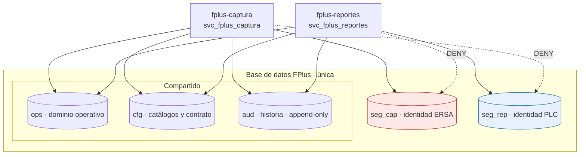
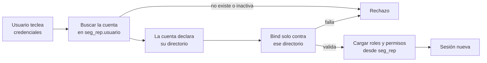

# 05 · Seguridad y control de acceso

> Estado: PRELIMINAR · línea base de trabajo v0.1
> La matriz concreta de roles y permisos depende de **P02** (roles, suplencias, visibilidad
> y evento de liberación), que sigue abierto. Este documento define la **estructura** del
> control de acceso, no la matriz. Los roles que aparecen son **ilustrativos**.

## Principio: identidad segregada por módulo

La base de datos es única, pero **los usuarios, sus contraseñas, sus roles y sus permisos
están separados por módulo**. `fplus-captura` y `fplus-reportes` tienen cada uno su propio
padrón de identidad, en su propio esquema de SQL Server, con su propio principal de
conexión.

Esto responde a tres cosas:

1. **NFR-008 · Confidencialidad funcional.** Está requerido mantener separada la información
   comercial entre la captura de ERSA y el intercambio externo. Compartir el padrón de
   usuarios entre ambos módulos erosiona esa separación desde la raíz.
2. **ERSA no es personal de Fresnillo.** Es un laboratorio representante. Su ciclo de alta,
   baja y revocación es distinto, lo administra alguien distinto, y no debería vivir en el
   mismo padrón que los usuarios internos de PLC.
3. **Contención del radio de daño.** `fplus-captura` puede quedar expuesto a internet. Si se
   compromete, el atacante obtiene lo que su principal de base de datos alcanza. Con la
   identidad segregada, eso **no incluye las credenciales de los usuarios internos de
   Fresnillo**.

El tercer punto es el que hace que valga la pena: la separación la impone el motor de base
de datos, no una condición WHERE en el código de la aplicación.

## Esquemas de identidad



`seg_cap` y `seg_rep` tienen **estructura idéntica** pero contenido y privilegios
completamente disjuntos.

### Estructura de cada esquema de identidad

```sql
-- Idéntico en seg_cap y en seg_rep. Se muestra seg_cap.
CREATE TABLE seg_cap.usuario (
    id                BIGINT IDENTITY PRIMARY KEY,
    usuario           NVARCHAR(64)  NOT NULL UNIQUE,
    nombre            NVARCHAR(200) NOT NULL,
    correo            NVARCHAR(256) NULL,
    clave_hash        NVARCHAR(512) NOT NULL,   -- Argon2id, nunca la contraseña
    clave_cambiada    DATETIME2     NOT NULL,
    activo            BIT           NOT NULL DEFAULT 1,
    bloqueado_hasta   DATETIME2     NULL,
    intentos_fallidos SMALLINT      NOT NULL DEFAULT 0,
    creado_en         DATETIME2     NOT NULL,
    creado_por        NVARCHAR(64)  NOT NULL,
    version           ROWVERSION
);

CREATE TABLE seg_cap.rol (
    id     INT IDENTITY PRIMARY KEY,
    codigo NVARCHAR(64)  NOT NULL UNIQUE,
    nombre NVARCHAR(200) NOT NULL,
    activo BIT NOT NULL DEFAULT 1
);

CREATE TABLE seg_cap.permiso (
    id     INT IDENTITY PRIMARY KEY,
    codigo NVARCHAR(64)  NOT NULL UNIQUE,   -- p.ej. ENSAYE_CAPTURAR
    nombre NVARCHAR(200) NOT NULL
);

CREATE TABLE seg_cap.rol_permiso (
    rol_id     INT NOT NULL REFERENCES seg_cap.rol(id),
    permiso_id INT NOT NULL REFERENCES seg_cap.permiso(id),
    PRIMARY KEY (rol_id, permiso_id)
);

CREATE TABLE seg_cap.usuario_rol (
    usuario_id   BIGINT NOT NULL REFERENCES seg_cap.usuario(id),
    rol_id       INT    NOT NULL REFERENCES seg_cap.rol(id),
    otorgado_en  DATETIME2    NOT NULL,
    otorgado_por NVARCHAR(64) NOT NULL,
    PRIMARY KEY (usuario_id, rol_id)
);
```

Los otorgamientos de rol llevan **quién y cuándo**: forman parte de la evidencia de
autoridad que pide NFR-007.

## Privilegios de base de datos

Cada módulo se conecta con su propio principal. Los privilegios son parte del esquema y se
aplican por migración Flyway, no a mano por el DBA.

```sql
-- Módulo expuesto: mínimo indispensable
GRANT SELECT, INSERT, UPDATE ON SCHEMA::ops      TO svc_fplus_captura;
GRANT SELECT                 ON SCHEMA::cfg      TO svc_fplus_captura;
GRANT INSERT                 ON SCHEMA::aud      TO svc_fplus_captura;
GRANT SELECT, INSERT, UPDATE ON SCHEMA::seg_cap  TO svc_fplus_captura;
DENY  SELECT, INSERT, UPDATE, DELETE ON SCHEMA::seg_rep TO svc_fplus_captura;

-- Módulo interno
GRANT SELECT, INSERT, UPDATE ON SCHEMA::ops      TO svc_fplus_reportes;
GRANT SELECT, INSERT, UPDATE ON SCHEMA::cfg      TO svc_fplus_reportes;
GRANT SELECT, INSERT         ON SCHEMA::aud      TO svc_fplus_reportes;
GRANT SELECT, INSERT, UPDATE ON SCHEMA::seg_rep  TO svc_fplus_reportes;
DENY  SELECT, INSERT, UPDATE, DELETE ON SCHEMA::seg_cap TO svc_fplus_reportes;
```

Puntos deliberados:

- **DENY, no simple ausencia de GRANT.** En SQL Server, `DENY` prevalece sobre cualquier
  `GRANT` heredado de un rol. Es explícito y sobrevive a un alta descuidada de permisos.
- **Ningún DELETE en `ops` ni en `aud`.** La historia no se borra (NFR-002). Las bajas son
  lógicas.
- **`aud` es append-only para ambos**, y `fplus-captura` ni siquiera puede leerla.
- **Ningún módulo usa `db_owner`, `sa` ni un usuario administrativo.** Las migraciones se
  aplican con un principal distinto, solo durante el despliegue.
- El alcance dentro de `ops` para `fplus-captura` se acotará a las tablas de captura cuando
  el modelo cierre; el `GRANT` a nivel esquema de arriba es provisional y **debe
  estrecharse**.

## Autenticación y sesión: Apache Shiro programático

El mecanismo es **Apache Shiro**, configurado **por completo en código**. No se usa
`shiro.ini` ([ADR-009](adr/ADR-009-apache-shiro-programatico.md)).

> **Versión.** Jakarta EE 11 usa el espacio de nombres `jakarta.*`. Shiro 1.x depende de
> `javax.servlet` y **no sirve**: se requiere **Shiro 2.x**. Verificar la versión exacta al
> fijar la dependencia.

### Configuración programática

El punto de entrada es un `WebEnvironment` propio, declarado con el parámetro de contexto
`shiroEnvironmentClass`. Ahí se arma el `SecurityManager`, el realm, el gestor de sesión y
el cadenado de filtros, sin archivo de configuración externo.

```java
public class EntornoSeguridadCaptura extends DefaultWebEnvironment {

    public EntornoSeguridadCaptura() {
        DefaultWebSecurityManager sm = new DefaultWebSecurityManager();
        sm.setRealm(new RealmCaptura());          // lee seg_cap, nunca seg_rep
        sm.setSessionManager(sessionManager());
        sm.setRememberMeManager(null);            // RememberMe deshabilitado, ver abajo
        setWebSecurityManager(sm);
        setFilterChainResolver(resolverDeCadenas());
    }
}
```

**`RememberMe` se deshabilita explícitamente** (`setRememberMeManager(null)`). Shiro lo
implementa con una cookie cifrada que transporta un objeto serializado; ha sido origen de
vulnerabilidades graves de deserialización, y aquí no aporta nada: no hay caso de uso que
justifique una sesión persistente en una aplicación con datos comerciales.

### Identificadores de sesión

Requisito: **CSPRNG con 128 bits de entropía como mínimo. Un UUID no lo satisface.**

Shiro trae `JavaUuidSessionIdGenerator` como generador por omisión, que **no cumple**. Se
sustituye por uno propio sobre `SecureRandom`:

```java
public final class GeneradorIdSesion implements SessionIdGenerator {

    private static final int BYTES = 32;                 // 256 bits
    private final SecureRandom aleatorio = new SecureRandom();

    @Override
    public Serializable generateId(Session session) {
        byte[] bytes = new byte[BYTES];
        aleatorio.nextBytes(bytes);
        return Base64.getUrlEncoder().withoutPadding().encodeToString(bytes);
    }
}
```

Esto obliga a usar el **gestor de sesión nativo de Shiro** (`DefaultWebSessionManager`), no
el del contenedor: con `ServletContainerSessionManager` el identificador lo emite Payara y
el generador no interviene. Shiro respalda `HttpServletRequest.getSession()`, así que JSF y
los beans de sesión siguen funcionando.

### Identificador nuevo en cada autenticación

Requisito: **toda autenticación emite un identificador de sesión nuevo e invalida el
anterior**, incluida la reautenticación.

**No se asume que el framework lo haga.** Se implementa de forma explícita: antes de
`subject.login(...)` se copia lo que deba sobrevivir, se detiene la sesión vigente y se crea
una nueva. La verificación es una **prueba automatizada obligatoria**: autenticar dos veces
y comprobar que el identificador cambió y que el anterior ya no resuelve.

### Cookie de sesión

```java
Cookie cookie = new SimpleCookie("__Host-fplus-cap-sid");
cookie.setSecure(true);        // exigido por el prefijo __Host-
cookie.setHttpOnly(true);
cookie.setPath("/");           // exigido por el prefijo __Host-
cookie.setSameSite(SameSiteOptions.STRICT);
// Sin atributo Domain: el prefijo __Host- lo prohíbe
```

Se usa el prefijo **`__Host-`**, no `__Secure-`: las cookies de los dos módulos no se
comparten entre hosts. El prefijo lo garantiza a nivel de navegador, lo que refuerza la
segregación de [ADR-004](adr/ADR-004-identidad-segregada-por-modulo.md) desde el cliente.

`fplus-reportes` usa `__Host-fplus-rep-sid`, con la misma configuración.

> **Consecuencia operativa:** `__Host-` exige `Secure`, y por tanto HTTPS **también en
> desarrollo local**. No se admite una variante sin prefijo para DEV: sería una
> configuración distinta de la de producción justo en el control que se quiere verificar.

### Verificación de contraseñas

Requisito: **verificar la contraseña exactamente como se recibe.** Sin truncar, sin plegar
mayúsculas, sin normalizar, sin restringir qué caracteres admite.

Consecuencia concreta en la elección del algoritmo: **bcrypt queda descartado.** Trunca la
entrada a 72 bytes, lo que es exactamente la violación que el requisito prohíbe, y lo hace
en silencio.

| Algoritmo | Veredicto |
| --- | --- |
| **Argon2id** | **Elegido.** Sin límite de longitud; parámetros de memoria, paralelismo e iteraciones explícitos |
| PBKDF2-HMAC-SHA-512 | Aceptable como alternativa. No trunca |
| bcrypt | **Prohibido.** Trunca a 72 bytes |
| `DefaultPasswordService` de Shiro | **No se usa.** Su servicio de hash por omisión no alcanza el nivel exigido |

Se implementa un `CredentialsMatcher` propio sobre Argon2id. Reglas de manejo del valor
recibido:

- Se toma como `char[]`, se convierte a bytes en **UTF-8** y se limpia el arreglo tras usarlo.
- **Sin `trim()`, sin `toLowerCase()`, sin normalización Unicode.** Un espacio al final es
  parte de la contraseña.
- **Sin lista de caracteres permitidos.** Se admite cualquier carácter, incluidos espacios y
  no-ASCII.
- La comparación del hash es en **tiempo constante**.
- Un máximo de longitud generoso es admisible solo para acotar el costo de cómputo, y en ese
  caso **rechaza con error explícito; nunca trunca en silencio**. El valor concreto es TBD.

### Enumeración de usuarios y bloqueo

- La respuesta ante credencial inválida es **idéntica** exista o no el usuario, en mensaje y
  en tiempo de respuesta observable.
- El contador de intentos y el bloqueo temporal viven en `seg_cap.usuario` /
  `seg_rep.usuario`. Umbral y duración: TBD (NFR-017).

## Autenticación contra directorio (LDAP)

Fresnillo autentica contra LDAP de forma habitual. FPlus lo soporta en `fplus-reportes`
([ADR-010](adr/ADR-010-autenticacion-por-directorio.md)).

**`fplus-captura` no usa LDAP.** Los analistas de ERSA son de un laboratorio externo y no
están en el directorio de Fresnillo: conservan credenciales locales con Argon2id. Es una
consecuencia natural de que sean audiencias distintas, y refuerza la separación de los dos
módulos.

### Un realm, N directorios por configuración

No se implementa un realm por servidor. Un solo realm lee la lista de directorios de un
archivo de propiedades y la mantiene en memoria. Agregar un cuarto directorio es
configuración, no código.

Un **directorio lógico** puede tener varios servidores, que son conmutación por error entre
sí:

```properties
# Directorio corporativo de Fresnillo: dos sitios, misma población de usuarios
fplus.directorio.fresnillo.servidores = ldaps://dc-sitio1:636, ldaps://dc-sitio2:636
fplus.directorio.fresnillo.baseDn     = ...
fplus.directorio.fresnillo.tlsMinimo  = TLSv1.3

# Met-Mex: organización distinta, directorio lógico distinto
fplus.directorio.metmex.servidores    = ldaps://...
fplus.directorio.metmex.baseDn        = ...
fplus.directorio.metmex.tlsMinimo     = TLSv1.3
```

Dentro de un mismo directorio lógico, recorrer los servidores hasta que uno responda es
correcto: es el mismo dominio de confianza y la misma población.

### El directorio se resuelve antes de conectar, no probando

**No se recorren todos los directorios hasta que alguno valide.** La secuencia es:



La cuenta local dice a qué directorio pertenece el usuario. El bind se hace **solo** contra
ese directorio. Esto no es una restricción añadida: es el mismo diseño que ya teníamos, donde
**la cuenta local es la compuerta**.

Dos riesgos que esto elimina, y que un recorrido ciego introduce:

| Riesgo del recorrido ciego | Por qué importa aquí |
| --- | --- |
| **La contraseña viaja a directorios ajenos al usuario** | Uno de los tres directorios es de **Met-Mex, la contraparte del intercambio**. Con recorrido ciego, las credenciales de empleados de Fresnillo llegarían al directorio de la contraparte en cada intento. Inaceptable |
| **Colisión de identidad entre directorios** | Un `jperez` de Fresnillo y un `jperez` de Met-Mex son personas distintas. Con usuario simple y «el que valide», el segundo puede aterrizar en la cuenta del primero |
| **Amplificación del bloqueo** | Un intento fallido dispararía el contador de intentos en los tres directorios, bloqueando la cuenta corporativa del usuario antes de lo previsto |

Y además **ahorra** trabajo: un bind por intento en vez de hasta tres.

### La identidad es calificada

Con más de un directorio, el nombre de usuario a secas deja de identificar a una persona. La
cuenta local se identifica por el par **(directorio, usuario)**:

```sql
ALTER TABLE seg_rep.usuario ADD
    origen_autenticacion NVARCHAR(16) NOT NULL,  -- LOCAL o DIRECTORIO
    directorio           NVARCHAR(32) NULL;      -- codigo del directorio logico

-- clave_hash pasa a ser anulable: las cuentas de directorio no la usan
-- Unicidad por par, no por usuario suelto
CREATE UNIQUE INDEX ux_usuario_directorio
    ON seg_rep.usuario (directorio, usuario);
```

`seg_cap.usuario` **no cambia**: ERSA es siempre local y su `clave_hash` sigue siendo
obligatorio.

### La autoridad sigue sin venir del directorio

Sin cambio respecto a [ADR-004](adr/ADR-004-identidad-segregada-por-modulo.md), y es lo que
hace seguro el esquema: **el LDAP autentica y nada más.** Los roles y permisos se resuelven
contra `seg_rep`. Validar contra cualquier directorio sin una cuenta local provisionada con
roles **no da acceso a nada**.

Está además prohibido por la línea base ([10](10-controles-owasp-asvs.md), patrón 6): la
autoridad no se deriva de grupos ni atributos de un proveedor de identidad. Ningún grupo de
Active Directory otorga permisos en FPlus.

### Controles obligatorios sobre la conexión

Activan la obligación residual R8 de [10 · Controles OWASP ASVS](10-controles-owasp-asvs.md),
que deja de ser residual y pasa a ser exigible:

- **Escapado RFC 4515** de todo valor interpolado en un filtro de búsqueda. El identificador
  que teclea el usuario llega al filtro: es exactamente el caso que el control señala.
- **Escapado RFC 4514** de todo valor que forme parte de un DN.
- **LDAPS o StartTLS siempre**, con validación del certificado del servidor y versión mínima
  explícita. Sin retroceso a LDAP en claro, **tampoco en desarrollo**.
- **Sin bind anónimo** para la búsqueda. Las credenciales de la cuenta de servicio son
  secreto sin valor por omisión: si faltan, la aplicación falla al arrancar.
- **Rechazar el bind con contraseña vacía.** Muchos servidores lo tratan como bind anónimo y
  responden éxito: sería una autenticación exitosa sin contraseña.
- La contraseña se envía al directorio **tal cual llega**, sin recortar ni normalizar.
- El nombre del directorio que validó se registra en el evento de auditoría (NFR-007).

### Acceso de Met-Mex: decisión pendiente

El tercer directorio es de **Met-Mex**. Antes de habilitarlo hay que resolver algo que no es
técnico:

- Los insumos de arquitectura registran que **el acceso técnico a Met-Mex no está aprobado**
  (TR M01/E03). Autenticar usuarios suyos implica un acceso que hoy no tiene aprobación.
- `fplus-reportes` contiene la conciliación interna, la posición de negociación y la
  comparación contra Met-Mex. **NFR-008 exige mantener separada esa información comercial.**
  Un usuario de la contraparte dentro de ese módulo es justo lo que el requerimiento busca
  evitar.

Mientras eso no se resuelva, el directorio de Met-Mex queda **configurado pero sin cuentas
locales asociadas**, que en este diseño equivale a sin acceso: sin cuenta provisionada, la
autenticación no otorga nada.

> **Decisión requerida.** Si Met-Mex debe ver algo, lo que corresponde evaluar es una
> superficie propia y acotada, no cuentas dentro del módulo interno. Depende de P02 y P03.

## Autorización: el código verifica permisos, no roles

Decisión importante, y es consecuencia directa de que **P02 esté abierto**.

El realm de cada módulo devuelve, además de los roles, el **conjunto de permisos** que esos
roles otorgan. El código declara lo que necesita en términos de permiso, nunca de rol:

```java
SecurityUtils.getSubject().checkPermission("ensaye:capturar");
```

Así, la matriz de roles vive **como dato**, no como código. Cuando P02 cierre y se defina
quién puede qué —y cuando cambie después, porque va a cambiar— se reasignan permisos a roles
en tablas. No se recompila ni se redespliega nada.

Si el código verificara roles directamente (`hasRole("SUPERVISOR_ERSA")`), cada ajuste de la
matriz de autoridades sería un cambio de código. Con la matriz explícitamente pendiente, eso
sería un error de diseño.

### Dónde se verifica

La comprobación vive en la **capa de servicio de aplicación**, que es el límite
transaccional y el único punto por el que pasa todo caso de uso. Una comprobación solo en la
vista es decorativa: oculta un botón, no protege la operación.

Las anotaciones de Shiro (`@RequiresPermissions`) requieren que el interceptor CDI esté
cableado. Mientras eso no se verifique en Payara, **la comprobación programática explícita
en el servicio es la vía obligatoria**; las anotaciones se admiten solo como refuerzo.

### La autoridad nunca viene de fuera

**Prohibido derivar autoridad de los grupos o atributos de un proveedor de identidad.**

Si más adelante se adopta SSO corporativo —hoy no aprobado—, ese proveedor aporta
**autenticación** y nada más. Los roles y permisos se resuelven siempre contra `seg_cap` o
`seg_rep`. Un grupo de directorio no otorga permisos en FPlus.

Es coherente con [ADR-004](adr/ADR-004-identidad-segregada-por-modulo.md): el punto de
cambio ante un SSO es el realm de Shiro, y la estructura de roles y permisos sobrevive
intacta.

### Permisos ilustrativos

> **Ilustrativos.** No son la matriz. La matriz real requiere P02.

Se usa el formato `dominio:accion` de Shiro. **Las asignaciones a roles son explícitas: no
se otorgan comodines** como `ensaye:*`, que convertirían un permiso nuevo en un permiso
concedido sin que nadie lo decida.

| Módulo | Permiso | Acción |
| --- | --- | --- |
| captura | `ensaye:capturar` | Capturar resultados por elemento |
| captura | `ensaye:corregir` | Corregir antes de autorizar |
| captura | `ensaye:revisar` | Marcar revisado |
| captura | `ensaye:autorizar` | Autorizar el ensaye |
| captura | `exportacion:ersa` | Exportar en el formato de controles de ERSA (RF-032) |
| captura | `seguridad:administrar` | Administrar usuarios de ERSA |
| reportes | `metmex:ingestar` | Cargar archivos de Met-Mex |
| reportes | `conciliacion:ver` | Ver la comparación PLC contra Met-Mex |
| reportes | `resultado:liberar` | Liberar como oficial PLC (RF-011) |
| reportes | `intercambio:ejecutar` | Registrar envío y recepción |
| reportes | `negociacion:decidir` | Registrar la decisión negociada |
| reportes | `terceria:solicitar` | Solicitar tercería |
| reportes | `historia:consultar` | Consultar historia y versiones |
| reportes | `seguridad:administrar` | Administrar usuarios de PLC |

Nótese que `seguridad:administrar` existe en ambos, pero **son permisos distintos en
padrones distintos**: quien administra los usuarios de ERSA no administra los de PLC.
## Auditoría con identidad segregada

Consecuencia de separar los padrones: **un evento de auditoría no puede tener llave foránea
a "el usuario"**, porque no hay una sola tabla de usuarios.

La atribución es compuesta:

```sql
CREATE TABLE aud.evento (
    id             BIGINT IDENTITY PRIMARY KEY,
    ocurrido_en    DATETIME2    NOT NULL,
    sistema        NVARCHAR(16) NOT NULL,   -- CAPTURA o REPORTES
    usuario        NVARCHAR(64) NOT NULL,   -- login dentro de ese sistema
    usuario_id     BIGINT       NOT NULL,   -- id dentro de seg_cap o seg_rep
    evento         NVARCHAR(64) NOT NULL,
    entidad        NVARCHAR(64) NOT NULL,
    entidad_id     NVARCHAR(64) NOT NULL,
    valor_anterior NVARCHAR(MAX) NULL,
    valor_nuevo    NVARCHAR(MAX) NULL,
    observacion    NVARCHAR(MAX) NULL
);
```

La identidad se **desnormaliza a propósito**: se guarda el login textual junto al id. Así el
evento sigue siendo legible aunque el usuario se dé de baja, se renombre, o su esquema no
sea accesible desde el módulo que consulta la historia. Es lo que exigen NFR-001 y NFR-007:
responsables, fechas, evento y contexto, auditables en el tiempo.

Sin esta desnormalización, `fplus-reportes` no podría mostrar el nombre de un capturista de
ERSA en la historia, porque tiene `DENY` sobre `seg_cap`. **Es el costo de la segregación, y
se paga aquí.**

## El costo de segregar, dicho claro

La separación tiene precio y conviene aceptarlo con los ojos abiertos:

| Costo | Mitigación |
| --- | --- |
| Una persona que legítimamente necesite ambos módulos tendrá **dos cuentas y dos contraseñas** | Debería ser un caso raro. Si resulta común, es señal de que la frontera entre módulos está mal trazada y hay que revisar P02 |
| **Dos pantallas de administración** de usuarios, una por módulo | Comparten estructura: mismo código, distinto esquema. Se implementa una vez y se parametriza |
| La historia no puede unir por llave foránea al usuario | Resuelto con la desnormalización de arriba |
| Dos padrones con políticas que mantener alineadas (caducidad, complejidad) | Política común documentada. No hay sincronización de datos, solo de reglas |

La alternativa —un solo padrón con una columna `sistema`— es más cómoda y **más frágil**:
una inyección SQL en el módulo expuesto alcanzaría los hashes de todos los usuarios
internos. La segregación se sostiene sola; la columna discriminadora depende de que ninguna
consulta olvide filtrar.

## Pendientes de seguridad

| Pendiente | Referencia |
| --- | --- |
| **¿ERSA entra desde internet?** Define si hace falta MFA, WAF y política de sesión reforzada | NFR-017 · el mayor de todos |
| Política de contraseñas: longitud mínima, caducidad, historial | NFR-017 · TBD |
| Longitud máxima admitida antes de rechazar (nunca truncar) | TBD |
| Umbral de bloqueo por intentos fallidos y duración | NFR-017 · TBD |
| Expiración de sesión e inactividad | NFR-017 · TBD |
| Parámetros de Argon2id: memoria, iteraciones y paralelismo | TBD · según capacidad del servidor |
| Cifrado en reposo: TDE en SQL Server, Always Encrypted para columnas sensibles | NFR-018 · TBD |
| Matriz de roles, suplencias y visibilidad | **P02** · bloqueante para la matriz |
| Visibilidad de campos internos frente a externos | **P03**, NFR-008 · TBD |
| Recuperación de contraseña: canal y verificación | TBD · ver control de cabeceras de correo en [10](10-controles-owasp-asvs.md) |

> No se aprueba CyberArk ni un SSO concreto. Si más adelante se adopta un proveedor de
> identidad corporativo, el punto de cambio es el **realm de Shiro** de cada módulo: la
> estructura de roles y permisos de este documento se conserva, y **la autoridad sigue sin
> derivarse de los grupos del proveedor**.

## Controles transversales

Este documento cubre identidad, autenticación y autorización. El resto de los controles de
aplicación —cabeceras HTTP, escapado de LDAP y JNDI, cabeceras de correo, registro,
vinculación de parámetros, dirección del cliente y TLS— está en
**[10 · Controles OWASP ASVS](10-controles-owasp-asvs.md)**, que es la línea base vinculante
para todo el código que se genere.
