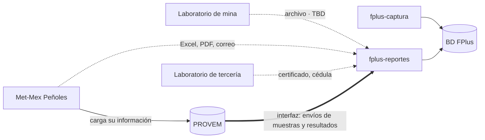

# 06 · Integraciones

> Estado: PRELIMINAR · línea base de trabajo v0.1

## Mapa de fronteras

Toda integración externa entra por `fplus-reportes`. El módulo expuesto no habla con
ningún sistema externo: solo con su propia base de datos.

## Decisiones por frontera

| Frontera | Mecanismo | Estado |
| --- | --- | --- |
| `fplus-captura` ↔ `fplus-reportes` | **Base de datos compartida. Sin API.** | Decidido · [ADR-002](adr/ADR-002-integracion-por-base-de-datos.md) |
| Met-Mex | Carga manual de archivo (Excel, PDF) y correo **para lo que no entre por PROVEM** | Decidido por restricción externa |
| Laboratorio de mina | Carga de archivo | TBD · formato y llaves |
| PROVEM | **Endpoint** (respuesta del 2026-10-21). FPlus extrae lotes cerrados, pesos y ponderados | Decidido el mecanismo en [ADR-013](adr/ADR-013-provem-por-endpoint.md); contrato de datos y llaves: P-005 |
| Correo (SMTP) | Bandeja de salida en la base; solo `fplus-reportes` envía | [ADR-014](adr/ADR-014-correo-por-bandeja.md); servidor: P-058 |
| Laboratorios de tercería | Carga del certificado por un usuario de PLC | Acceso directo **no aprobado** |

## Met-Mex

No hay ni habrá API en el corto plazo: **el acceso técnico a Met-Mex no está aprobado**. El
intercambio real hoy es por archivo y correo, y el sistema debe acompañar ese proceso, no
sustituirlo.

Lo que hace FPlus:

- Permite **cargar** el archivo que manda Met-Mex y registrar su recepción.
- Permite **generar** la salida que Fresnillo manda a Met-Mex.
- Registra el envío con fecha, responsable y evidencia adjunta.

Advertencia explícita, tomada de los insumos de arquitectura: **cargar copia del correo al
sistema no reemplaza el envío simultáneo ni demuestra integridad**. El sistema conserva
evidencia; no certifica que el intercambio haya ocurrido correctamente.

> **TBD (P08):** formato real de los archivos, llaves de correspondencia con el lote,
> manejo de duplicados y de cargas parciales fallidas. Sin esto no se puede diseñar el
> parser.

## Cédula externa y exportación ERSA

Son **objetos distintos** y no deben confundirse en el diseño:

| Objeto | Qué es | Dónde |
| --- | --- | --- |
| Exportación ERSA (RF-032) | Excel para controles internos de ERSA | `fplus-captura` |
| Cédula externa | Documento del intercambio con la contraparte | `fplus-reportes` |
| Excel de Met-Mex | Archivo que **llega** de la contraparte | `fplus-reportes` |

Confundirlos arriesga exponer información comercial por el canal equivocado, que es
exactamente lo que NFR-008 busca evitar.

## PROVEM · la interfaz que sí va a existir

**Cambio respecto a lo que decía este documento.** PROVEM deja de ser un "por definir"
genérico: **el sistema se va a conectar a una interfaz de PROVEM**, que es donde **Met-Mex
carga su información**, para extraer **envíos de muestras y algunos resultados**.

Esto reordena el mapa:

- La información de Met-Mex **no llega solo por Excel y correo**. Una parte entra por PROVEM.
- **No contradice** que el acceso técnico a Met-Mex no esté aprobado (TR M01/E03): FPlus no
  se conecta a Met-Mex, se conecta a **PROVEM**. Met-Mex deposita ahí. La frontera
  organizacional no se cruza.
- Es una **integración real**, no una carga manual. Es la primera del sistema.

### Qué se extrae

| Dato | Estado |
| --- | --- |
| Envíos de muestras | Confirmado como alcance de la interfaz |
| Algunos resultados | Confirmado, pero **cuáles** está por precisar |
| Identificación de lotes, cierre, peso seco | Ya se buscaba en PROVEM. Confirmar si entra por la misma interfaz |

### Lo que esto obliga a decidir

La ingesta deja de ser una pantalla de carga y pasa a ser un proceso. Si la carga
terminara siendo automática o programada, convendría evaluar sacarla a un componente propio
en lugar de incrustarla en una aplicación de consulta. **Ese caso se materializó**, y
[ADR-013](adr/ADR-013-provem-por-endpoint.md) decidió dejarla en `fplus-reportes` con un
candado de una sola ejecución.

> **Validación — 2026-10-21** (`nemit:validador`): este párrafo citaba esa advertencia como
> texto de [02](02-vista-de-modulos.md), y 02 no la contiene. Se quitó la atribución; el
> contenido no cambia.

| Decisión | Por qué importa |
| --- | --- |
| **¿Dónde vive la ingesta?** Dentro de `fplus-reportes` o como componente propio | Un proceso programado dentro de una aplicación web se ejecuta tantas veces como instancias haya. Si alguna vez hay más de una, se duplica la carga |
| **¿Extracción periódica o bajo demanda?** | Define si hace falta un planificador, y con él el problema de la ejecución duplicada |
| **¿Qué tipo de interfaz?** REST, SOAP, vista de base de datos, tabla de paso, depósito de archivos | Cambia por completo el diseño del cliente. **Es lo primero que hay que averiguar** |
| **¿Llaves de correspondencia?** | Sin ellas no se puede detectar el duplicado ni vincular al lote. Es **P08**, que sigue abierto |
| **¿Qué pasa si PROVEM no responde?** | Define si la operación se detiene o continúa con captura manual |

### Lo que ya está resuelto por diseño

La recomendación previa de este documento paga aquí: se modelaron los campos de PROVEM como
**capturables manualmente con el origen marcado**. Cuando entre la interfaz, el origen cambia
de `MANUAL` a `PROVEM` **sin alterar el modelo**. La ingesta automática y la captura manual
conviven sin dos caminos de datos distintos.

### Controles obligatorios sobre esta interfaz

Es una conexión saliente hacia un sistema externo, así que aplica la línea base
([10](10-controles-owasp-asvs.md)):

- **TLS con validación de certificado y versión mínima explícita.** Sin retroceso a texto
  plano, tampoco en desarrollo.
- **Credenciales de la interfaz cifradas en la base**, capturadas por pantalla y nunca mostradas; si faltan, la
  integración queda apagada y la pantalla lo dice, sin impedir que la aplicación arranque (AR-G-23, AR-G-03;
  precisado por [ADR-013](adr/ADR-013-provem-por-endpoint.md) el 2026-10-21).
- Lo que llegue de PROVEM es **dato externo, no confiable**: se valida, se registra su origen
  y se conserva la carga original como evidencia.
- **Idempotencia o detección de duplicado.** Una extracción repetida no puede producir dos
  veces el mismo envío de muestra. Depende de las llaves de P08.
- **Fallo parcial visible.** Si vienen doscientos registros y fallan tres, el usuario ve
  cuáles y por qué.
- El resultado de la extracción se registra en auditoría con su origen y momento (NFR-007).
- Si la interfaz es de tipo consulta, toda consulta es **parametrizada**: ningún valor se
  concatena.

> **Actualizado el 2026-10-21.** La naturaleza ya se sabe: un endpoint. Dónde vive el cliente, cómo se dispara,
> cómo se evita la ejecución duplicada y qué pasa si PROVEM no responde quedan en
> [ADR-013](adr/ADR-013-provem-por-endpoint.md). Sigue pendiente el contrato de datos y sus llaves (P-005): sin
> ellos no se escribe el cliente.
## Sobre SISLIQ y BDO

Aparecen como rótulos en los bocetos observados. **No hay evidencia de interfaz implementada
ni de relación técnica entre esos sistemas y FPlus.** No deben aparecer en el diseño hasta
que exista una decisión explícita.

## Principios de integración

1. **Toda entrada externa es dato sospechoso.** Se valida, se registra su origen y se
   conserva el archivo original como evidencia.
2. **La carga es idempotente o detecta el duplicado.** Cargar dos veces el mismo archivo de
   Met-Mex no puede producir dos lotes.
3. **Fallo parcial visible.** Si un archivo trae 200 renglones y 3 fallan, el usuario ve
   cuáles y por qué. Nunca un fallo silencioso ni una carga a medias sin aviso.
4. **El origen del dato se conserva siempre** (NFR-007): qué archivo, quién lo cargó, cuándo.
5. **Sin borrado de evidencia.** Una carga equivocada se corrige con una carga nueva que
   deja historia, no borrando la anterior.

> Los puntos 2 y 3 dependen de P08 (llaves y duplicados) para poder implementarse de verdad.
