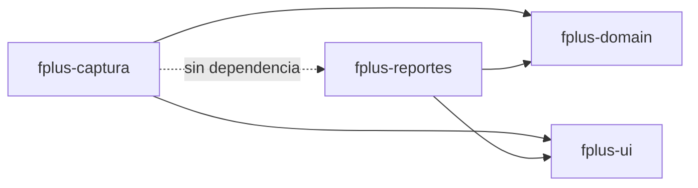

# 09 · Interfaz y tema visual

> Estado: PRELIMINAR · línea base de trabajo v0.1
> El alcance del diseño visual depende de NFR-022 (dispositivos y navegadores) y NFR-023
> (accesibilidad), ambos sin definir.

## Situación

PrimeFaces 16 no aporta un tema listo para usar en este proyecto: **el tema se diseña
completo**, desde los tokens de color hasta el comportamiento de cada estado de componente.

Esto deja de ser un asunto de presentación y pasa a ser arquitectura por dos razones:

1. **Es un artefacto compartido entre dos desplegables independientes.** Los dos módulos
   son el mismo sistema para el negocio. Si cada WAR lleva su propio CSS, divergen a la
   primera corrección.
2. **Es un frente de trabajo con esfuerzo propio**, no un ajuste al final. Debe planearse y
   asignarse como cualquier otro componente.

## Decisión: un artefacto de interfaz compartido

Se agrega un tercer módulo Maven, `fplus-ui`, empaquetado como JAR de recursos web
([ADR-007](adr/ADR-007-tema-propio-compartido.md)):

```
fplus/
├── pom.xml
├── fplus-domain/     JAR · dominio y persistencia
├── fplus-ui/         JAR · tema, layout y componentes compuestos
├── fplus-captura/    WAR · depende de domain y de ui
└── fplus-reportes/   WAR · depende de domain y de ui
```



`fplus-ui` contiene:

| Contenido | Qué es |
| --- | --- |
| Tokens de diseño | Variables CSS: color, tipografía, espaciado, radios, sombras |
| Skin de componentes PrimeFaces | Estilos de tablas, formularios, botones, diálogos, mensajes |
| Plantilla de layout | Cabecera, navegación, área de contenido, pie (Facelets) |
| Componentes compuestos | Piezas propias reutilizables: campo de valor de ensaye, indicador de estado, bloque de historia |
| Iconografía | Conjunto único para ambos módulos |

Lo que **no** contiene: pantallas, backing beans ni nada específico de un módulo.

## Los dos módulos deben distinguirse a simple vista

Mismo sistema de diseño, **identidad visual distinguible por módulo**.

Un usuario debe saber sin pensarlo en cuál de los dos está. No es preferencia estética: son
dos aplicaciones con padrones de usuario distintos, potencialmente en redes distintas, y
una de ellas puede estar expuesta a internet. Confundirlas tiene consecuencias — desde
capturar en el lugar equivocado hasta no notar una pantalla de acceso falsa.

Mecanismo recomendado: un color de acento y un identificador de módulo permanentes en la
cabecera, sobre el mismo sistema de diseño. Se resuelve con un token que cada WAR define;
no duplica el tema.

## Densidad: es un requerimiento, no un gusto

`fplus-captura` es una aplicación de captura numérica intensiva, y `fplus-reportes` muestra
tablas comparativas amplias. NFR-003 prioriza rapidez y NFR-004 minimizar interacciones.

Consecuencias para el tema:

- **Densidad compacta por defecto** en tablas y formularios. Menos desplazamiento, más
  datos por pantalla.
- **Navegación completa por teclado** en la captura: tabulación predecible, sin obligar a
  tomar el ratón entre campo y campo.
- **Objetivos táctiles y de foco amplios** sin inflar la altura de fila.

Un tema holgado y espacioso se ve bien en una demostración y estorba a quien captura
doscientos valores al día.

## Presentación de valores numéricos

El tema carga aquí una responsabilidad que normalmente no tendría, y viene del modelo de
datos:

- **Un valor tiene cuatro estados que deben verse distintos** (NFR-009): cero real,
  pendiente, ausente y no aplica. No es la dicotomía «cero contra vacío». Si la
  interfaz colapsa varios de ellos en una celda vacía, el problema reaparece donde más
  daño hace: en la comparación visual contra Met-Mex. El tema define **cuatro
  representaciones distinguibles**, y ninguna puede confundirse con `0`.
- **Alineación a la derecha y decimales consistentes** en toda columna numérica.
- **La unidad se muestra siempre**, nunca se asume (NFR-010).
- **Las diferencias fuera del límite de partición se marcan visualmente**, sin depender solo
  del color: también forma o texto, para no excluir a quien no distingue ciertos colores.

## Accesibilidad

NFR-023 está sin definir, pero hay un piso que conviene fijar desde el inicio porque
rehacerlo después es caro:

- Contraste suficiente entre texto y fondo en todos los estados.
- **Foco siempre visible.** No eliminar el indicador de foco del navegador sin sustituirlo
  por uno propio con contraste.
- El color nunca es el único portador de información.
- Etiquetas asociadas a cada campo, y mensajes de error anunciables por lector de pantalla.
- Toda acción alcanzable por teclado.

> **TBD (NFR-023):** nivel de conformidad exigido y criterio de evaluación. Lo anterior es
> el mínimo razonable, no un compromiso de cumplimiento.

## Tres modos de visualización

El tema se construye con **tres modos**, no uno
([ADR-008](adr/ADR-008-tres-modos-de-visualizacion.md)):

| Modo | Para qué | Carácter |
| --- | --- | --- |
| **Claro** | Uso general, oficina con buena iluminación | Fondo claro, contraste alto. Es el modo por omisión |
| **Descansa vista** | Jornadas largas de captura o de análisis | Fondo cálido y de baja emisión, contraste moderado sin caer bajo el mínimo legible |
| **Oscuro** | Poca luz ambiental, turnos nocturnos | Fondo oscuro, texto claro, sin negro puro ni blanco puro |

El modo **descansa vista** no es un adorno: `fplus-captura` se usa para meter valores
numéricos durante horas seguidas, y `fplus-reportes` para leer tablas comparativas densas.
Es fatiga visual real.

### Consecuencia: los tokens son semánticos, no literales

Esta es la razón por la que decidirlo ahora importa y no después.

Con tres modos, un token **no puede** nombrar un color:

```css
/* Mal: el nombre deja de ser cierto en cuanto cambia el modo */
--gris-claro: #f2f2f2;
--azul-marca: #1a4f8a;

/* Bien: el nombre dice la función, cada modo le da su valor */
--superficie-base
--superficie-elevada
--texto-primario
--texto-tenue
--borde-sutil
--acento
--estado-error
--estado-fuera-de-limite
```

Los tres modos redefinen **el mismo conjunto** de tokens semánticos. Ninguna hoja de estilo
ni componente conoce el modo activo: consume tokens.

Adoptar esta disciplina desde el inicio cuesta poco. Retrofitearla sobre un CSS con colores
literales dispersos es una reescritura completa. Por eso entra hoy.

### Implementación

- Un atributo en la raíz del documento (`data-tema="claro | descansa-vista | oscuro"`) es
  lo único que cambia. Las variables CSS hacen el resto.
- **El cambio de modo no recarga la página ni pierde el estado del formulario.** Alternar
  el modo a media captura no puede costarle a nadie lo que llevaba escrito. La persistencia
  ocurre de forma asíncrona, después del cambio visual.
- En el primer acceso, si el usuario no ha elegido, se respeta la preferencia del sistema
  operativo (`prefers-color-scheme`) entre claro y oscuro.

### Dónde vive la preferencia

Consecuencia directa de la identidad segregada
([ADR-004](adr/ADR-004-identidad-segregada-por-modulo.md)): la preferencia se guarda **en
el esquema de identidad de cada módulo** (`seg_cap` y `seg_rep`), no en una tabla
compartida.

Implica que alguien con cuenta en ambos módulos elige su modo dos veces. Es coherente con
la segregación y evita abrir una tabla de usuarios común por la puerta trasera. Una
preferencia visual no justifica romper el aislamiento que protege las credenciales.

### Lo que los tres modos obligan a verificar

- **El contraste se valida en los tres**, no solo en claro. La superficie de verificación de
  accesibilidad se triplica (NFR-023).
- **"Descansa vista" no puede significar "ilegible".** Hay una tensión real entre bajar la
  agresividad visual y mantener contraste suficiente; el mínimo legible manda sobre la
  suavidad.
- **Los colores de estado funcionan en los tres.** La marca de diferencia fuera del límite
  de partición no puede depender de un rojo que se pierde en fondo oscuro. Refuerza la regla
  de que el color nunca es el único portador de información.
- **Los cuatro estados de un valor siguen siendo distinguibles en los tres modos**, no solo
  en claro.
- **Impresión y exportación usan siempre la paleta clara**, sin importar el modo activo. Un
  PDF en modo oscuro es ilegible y desperdicia tóner.

## Pendientes

| Pendiente | Impacto |
| --- | --- |
| **¿Existe guía de marca de Fresnillo aplicable?** | Define paleta y tipografía, o confirma que se parte de cero |
| **Definición de las tres paletas** (claro, descansa vista, oscuro) | **En aprobación.** Se esperan hacia el 25 de septiembre de 2026, como imágenes de los tres temas. De ahí se derivan los tokens semánticos |
| **NFR-022 · navegadores y dispositivos** | Define si hay que soportar navegadores antiguos y si el uso es solo de escritorio. Condiciona todo el CSS |
| **¿Quién diseña el tema?** | Es trabajo de diseño, no de desarrollo. Requiere asignación explícita |
| **¿Se evaluó un tema comercial de PrimeFaces?** | Cambiaría el esfuerzo de forma sustancial. Conviene confirmar que se descartó y por qué |
| **Uso en tableta o en piso** | Si los analistas capturan fuera del escritorio, cambia la densidad y los objetivos táctiles |

## Regla de trabajo

Ningún estilo se escribe en una pantalla. Todo lo visual vive en `fplus-ui`. Si una pantalla
necesita algo que el tema no ofrece, se agrega al tema —para los dos módulos— en lugar de
resolverlo localmente con CSS incrustado.

Es la única forma de que un sistema con dos desplegables no termine pareciendo dos sistemas.
